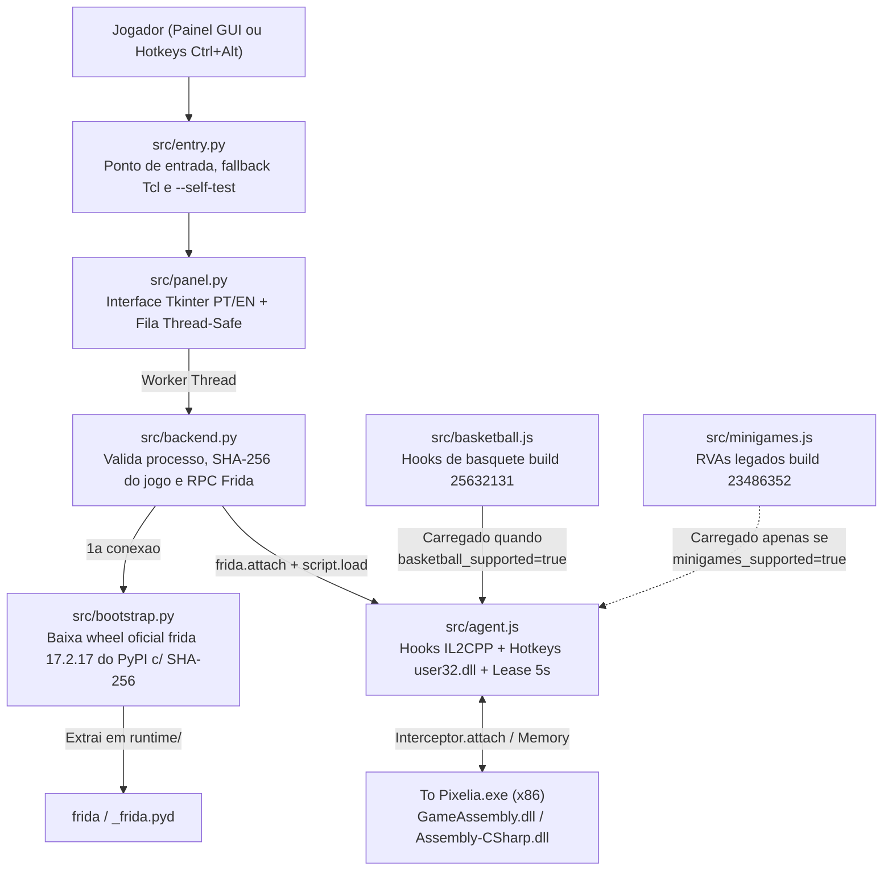
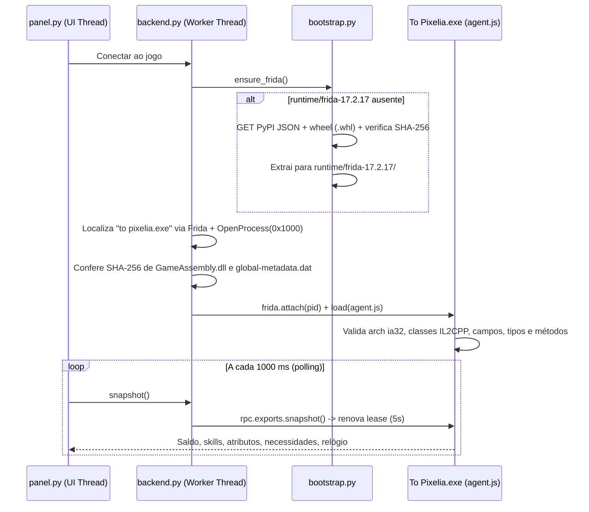

# Arquitetura Interna — Pixelia Livre

O **Pixelia Livre** é dividido em uma interface desktop desacoplada (Python + Tkinter), um gerenciador de conexão/integridade (Python + `ctypes` + Frida RPC) e um agente JavaScript executado dentro do runtime IL2CPP do jogo.

---

## Visão Geral dos Componentes

---

## Fluxo de Conexão e Segurança por Etapa

---

## Responsabilidade de Cada Arquivo em `src/`

| Arquivo | Papel no Projeto |
| --- | --- |
| [`src/entry.py`](../src/entry.py) | Inicializa a aplicação Tkinter, aplica fallback para `C:/Python312/tcl` caso o ambiente restrinja scripts Tcl em *Documentos* e implementa `--self-test`. |
| [`src/panel.py`](../src/panel.py) | Constrói toda a UI bilíngue (**PT** / **EN**), executa chamadas ao backend em thread separada (`pixelia-worker`) e mantém a UI responsiva com filas `queue.Queue`. |
| [`src/backend.py`](../src/backend.py) | Consulta o caminho exato de `To Pixelia.exe` via `kernel32.dll`, valida hashes SHA-256 contra `compatibility.json`, injeta `agent.js` e grava diagnósticos em `PixeliaLivre.log`. |
| [`src/bootstrap.py`](../src/bootstrap.py) | Faz o download verificado (HTTPS + whitelist PyPI + SHA-256 + proteção contra Zip Slip) do wheel `frida-17.2.17` para `runtime/frida-17.2.17/`. |
| [`src/agent.js`](../src/agent.js) | Resolve APIs exportadas por `GameAssembly.dll` (`il2cpp_*`), valida classes e offsets de `Assembly-CSharp.dll`, anexa hooks em `Player.Update`, `TimeManager.Update`, `UIManager.Update` e `TimeManager.UpdateGameSecond`, além de gerenciar hotkeys via `user32.dll` e o *lease* de 5 segundos. |
| [`src/basketball.js`](../src/basketball.js) | Hooks revalidados para a build `25632131` em `Player_Basketball` (`0x60cb6e`) e `StreetBasketballPlayer` (`0x52c79a`), garantindo acertos de arremessos quando `options.autoBasket` está ativo e mantendo o loop `frame()` ativo nas cenas de basquete. |
| [`src/minigames.js`](../src/minigames.js) | Definições de hooks legados para os demais minigames (Steam build `23486352`). Só é concatenado ao script quando `"minigames_supported": true` no manifesto. |
| [`src/compatibility.json`](../src/compatibility.json) | Manifesto declarando jogo, Steam App ID (`1954160`), versão (`1.1.28`), Steam build (`25632131`), flags `minigames_supported` (`false`) e `basketball_supported` (`true`) e hashes SHA-256 exigidos. |
| [`src/build.py`](../src/build.py) | Script PyInstaller (`--onedir --windowed --exclude-module frida`) que empacota `PixeliaLivre.exe` com `agent.js`, `basketball.js`, `minigames.js`, `compatibility.json` e `python3.dll`. |

---

## Detalhes Técnicos Importantes do Agente (`agent.js`)

1. **Multiplicador seguro do relógio (`clockOrigins`):**
   - Ao inicializar, o agente lê até 100 instruções x86 a partir de `TimeManager.Update` usando `Instruction.parse` e registra os endereços de retorno de chamadas diretas (`call`) para `TimeManager.UpdateGameSecond`.
   - Quando `UpdateGameSecond` é chamado, o agente só replica ticks extras (`options.speed - 1`) se o `returnAddress` pertencer a `clockOrigins`, se o incremento for de 1 segundo normal (`args[1] === 1 && args[2] !== 0`), e se `!gameClockPaused && gameClockCanWork`. Saltos de tempo scriptados do jogo (dormir, viagens, eventos) não são multiplicados.
2. **Lease de segurança (Dead-man's switch de 5 segundos):**
   - Sempre que `snapshot()` ou `command()` é chamado, `lease = Date.now()` é atualizado.
   - Se o painel travar ou fechar inesperadamente e `Date.now() - lease > 5000`, `frame()` reseta `options = defaults()`, desativando imediatamente manutenção de necessidades, saúde e aceleração.
3. **Verificação estrita de tipos IL2CPP:**
   - Antes de ativar qualquer hook, `field(c, n, t, stat)` verifica nome, tipo (`System.Single`, `System.Int32`, `System.Boolean`, etc.) e flag estática (`0x10`), evitando escrita corrompida caso uma atualização altere estruturas internas.
